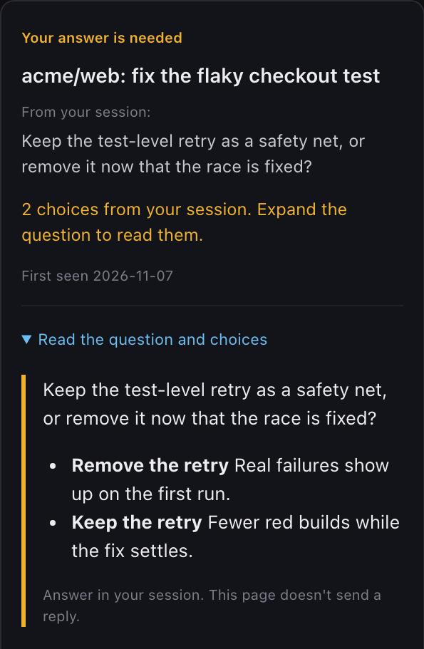
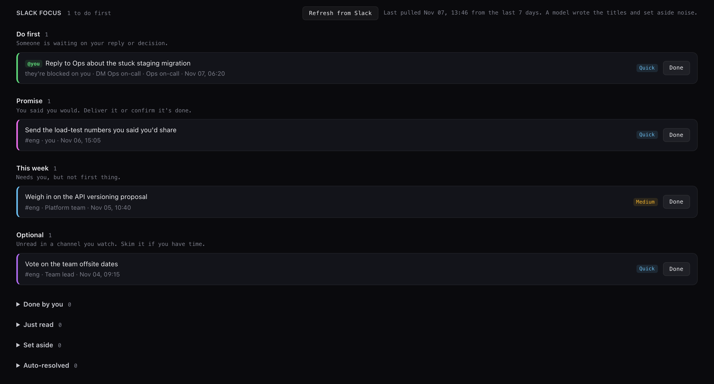
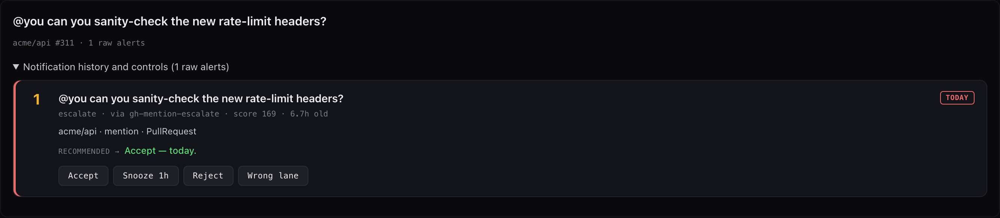

# Assistant


**Assistant is a chief of staff for your fleet of Claude Code agents.**

It watches every agent session you run in cmux, plus your Slack and inbox. It
shows you only what needs you, and it handles the work around your agents:
starting sessions, answering you on Slack, and cleaning up after them.


## What it does

| You want to | How Assistant helps |
|---|---|
| **See every session** | The **Sessions** tab sorts your cmux workspaces into Needs your answer, Assistant tasks, Ready to close, and Paused. |
| **Answer agents in seconds** | A card quotes the agent's question and choices, then takes you to the right session. |
| **Turn a task into a session** | Add a task with `/todo`, and Assistant opens a Claude session to work on it. |
| **Start background work** | `/spawn-claude-workspace` starts an agent in a new cmux workspace without taking your focus. |
| **Clean up when you're done** | `/cleanup` stops dev servers, saves uncommitted changes, and removes the branch and worktree. `/cleanup --undo` brings them back. |
| **Talk to your Mac from Slack** | A Claude session answers your messages in a private Slack channel and pings you when a workspace needs you. |
| **Save a Slack thread as a task** | React with your machine's emoji, and the thread becomes a task, which then gets its own session. |
| **Find Slack threads that need you** | The **Slack** tab lists threads where someone is waiting on you or you promised something. |
| **One list for your inbox** (Pro mode) | The **Notifications** tab ranks GitHub, Gmail, Google Calendar, Outlook, and Slack alerts, and stays current. |
| **Track ranked goals** (Pro mode) | `/goal` records your goals, and a planner suggests the next step when one stalls. |
| **Recover from crashes** | Workspaces that crash come back on their own. Opt in with `--with-crash-resume`. |
| **Keep your Macs in sync** | Claude memory syncs across your Macs. Opt in with `--with-memory`. |

## A closer look

### Answer your agents without opening every terminal

When an agent asks you something, its card quotes the question and the choices.
You decide in seconds, then jump straight to the right session.



### See the Slack threads where the next move is yours

The **Slack** tab pulls out the threads where someone is waiting on you or
you promised something. You stop scrolling channels to find them.



### Rank your notifications instead of reading them all (Pro mode)

Rules sort every notification into escalate, staged, digest, or drop, and rank
what's left. You see the few decisions that matter, and **Wrong lane** teaches
the rules with one tap.



### Also in the box

- `[N]` numbers and colors for your cmux sidebar. To turn them off, install
  with `--no-ws-numberer`.
- Silent by default: Assistant never sends mail or posts Slack as you, and the
  Slack bot can post only in your private channel. See the
  [design reference](docs/design.md).

## Pro mode

Turn Pro mode on or off in the dashboard's **Settings and background
services**, or run `./install.sh --apply --pro` (or `--no-pro`). Pro mode adds:

- The **Notifications**, **Decisions**, **Background work**, and **Connected
  apps** tabs, with triage ranking your notifications.
- Read-only connectors for GitHub, Gmail, Google Calendar, Outlook, and Slack,
  which you set up separately. See [Connect your sources](docs/connectors.md).
  In default mode they wait without polling.
- Ranked goals with the `/goal` skill, and a planner that suggests next steps.
- `/back-off` and `/attend` tell Assistant to leave a workspace alone or watch
  it again. `/lesson` saves a rule that future sessions follow.
- Background jobs that each need their own setting: the Observer
  (`ASSISTANT_WATCHER=1`), the strategist (`ASSISTANT_STRATEGIST=1`), the
  lessons extractor (`ASSISTANT_LESSON_EXTRACTOR=1`), and the brief narrator
  (`ASSISTANT_BRIEF_NARRATOR=1`).

## Quick start

To install, run the bootstrap script:

```bash
bash <(curl -fsSL https://raw.githubusercontent.com/elitecoder/assistant/main/install-bootstrap.sh)
```

Set `ASSISTANT_REPO_DIR` to clone somewhere other than `~/dev/assistant`, or
`ASSISTANT_REPO_URL` to clone over SSH. Check that it's running, then open
http://127.0.0.1:9876:

```bash
launchctl list | grep com.assistant
~/dev/assistant/bin/assistant-doctor.py
```

To look before you install anything, do a dry run. `install.sh` changes nothing
unless you pass `--apply`:

```bash
git clone https://github.com/elitecoder/assistant.git
cd assistant
./bin/assistant-doctor.py     # read-only preflight
./install.sh                  # prints what it would change
```

A bare `./install.sh --apply` loads the core set: `assistant-pulse`,
`world-scanner`, `session-context-watcher`, `assistant-page`, and
`assistant-todo-server`. Other daemons load only if you opt in. For the full
walkthrough, see [ONBOARDING.md](ONBOARDING.md).

## Requirements

- macOS
- `git`
- Python 3.11 or later
- The [Claude Code CLI](https://claude.ai/code)
- The cmux app, for the workspace features
- [`uv`](https://docs.astral.sh/uv/) (optional; it makes setup faster)

## Learn more

| Topic | Where |
|---|---|
| Install, opt-in features, and troubleshooting | [ONBOARDING.md](ONBOARDING.md) |
| Connect GitHub, Gmail, Google Calendar, Outlook, and Slack | [docs/connectors.md](docs/connectors.md) |
| Using the dashboard tabs and decision cards | [docs/dashboard.md](docs/dashboard.md) |
| Noise budget, wake hour, planner, Strategist, and model settings | [docs/configuration.md](docs/configuration.md) |
| Lanes, ranking, outbound gates, design decisions, and code map | [docs/design.md](docs/design.md) |
| Slack comms design | [docs/assistant-comms-onboarding.md](docs/assistant-comms-onboarding.md) |
| Slack emoji-to-TODO capture | [slack-reactor/README.md](slack-reactor/README.md) |

## Development

The core is standard-library Python; `pyproject.toml` lists no dependencies.
Run the tests:

```bash
uv run --with pytest python -m pytest tests/ -q
```

The Observer eval replays 14 real workspace transcripts against the verdict
prompt. Run it after any change to
[`prompts/observer-batch-prompt.md`](prompts/observer-batch-prompt.md) or
`bin/build-ws-context.py`:

```bash
cd evals/observer && ./run.py
```

Before review, follow the
[new-code quality checks](tests/README.md#check-new-code-before-review). Release
notes live in [CHANGELOG.md](CHANGELOG.md); the current release is 0.7.4.
