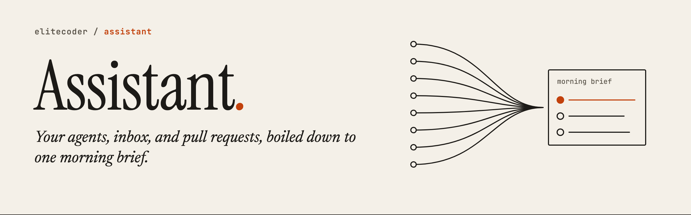

<picture>
  <source media="(prefers-color-scheme: dark)" srcset="docs/images/banner-dark.png">
  
</picture>


You start a dozen Claude Code agents, walk away, and come back to a wall of
terminals, pull requests, Slack pings, and email. Assistant watches your agents,
inbox, Slack, GitHub, calendar, and goals, handles what's safe, and hands you
one morning brief with only the decisions you need to make. It runs on your own
Mac as a few small LaunchAgents and a dashboard at `http://127.0.0.1:9876`.

<picture>
  <source media="(prefers-color-scheme: dark)" srcset="docs/images/overview-dark.png">
  
</picture>

Plain Python decides what happens to every item and is the only thing that can
act. Out of the box, Assistant is silent: you read the brief when you're ready.

## What a morning looks like

<picture>
  <source media="(prefers-color-scheme: dark)" srcset="docs/images/brief-dark.png">
  
</picture>

Those seven events are the repo's own policy fixtures
(`evals/policy/*/event.json`) run through the real triage and brief code. Every
event matched a rule, so no model call was involved. The day's metrics row
records the number Assistant tries to push down, `decisions_pending_at_brief`:

```json
{"date": "2026-07-03", "decisions_pending_at_brief": 4, "auto_coverage_pct": 0.0,
 "expired_unseen": 0, "interrupts_delivered": 0, "interrupts_denied": 0,
 "goals_progressed_overnight": 0, "staged_accept_rate": 0.0}
```

Your agents get the same treatment. Every 5 minutes, the pulse asks a model for
one verdict per workspace, and a Python table turns it into an action:

<picture>
  <source media="(prefers-color-scheme: dark)" srcset="docs/images/verdicts-dark.png">
  
</picture>

```json
{"ws_ref": "workspace:N", "verdict": "active", "summary": "Re-running combined keyboard + zoom suite at workers=6 to verify the 4.8x speedup holds.", "next": "Suite finishes; agent assesses whether the speedup regresses any spec."}
```

That example is from [the Observer prompt](prompts/observer-batch-prompt.md).

## Quick start

You need macOS, `git`, Python 3.11 or later, and the
[Claude Code CLI](https://claude.ai/code). The workspace features also need the
cmux app. [`uv`](https://docs.astral.sh/uv/) is optional and makes setup faster.

<picture>
  <source media="(prefers-color-scheme: dark)" srcset="docs/images/install-dark.png">
  
</picture>

To install, run the bootstrap script:

```bash
bash <(curl -fsSL https://raw.githubusercontent.com/elitecoder/assistant/main/install-bootstrap.sh)
```

Set `ASSISTANT_REPO_DIR` to clone somewhere other than `~/dev/assistant`, or
`ASSISTANT_REPO_URL` to clone over SSH. Check that it's running, then open
http://127.0.0.1:9876:

```bash
launchctl list | grep com.assistant
~/dev/assistant/bin/assistant-doctor.py
```

To look before you install anything, do a dry run. `install.sh` changes nothing
unless you pass `--apply`:

```bash
git clone https://github.com/elitecoder/assistant.git
cd assistant
./bin/assistant-doctor.py     # read-only preflight
./install.sh                  # prints what it would change
```

For the full walkthrough, see [ONBOARDING.md](ONBOARDING.md). To connect
GitHub, Gmail, Google Calendar, Outlook, or Slack, see
[Connect your sources](docs/connectors.md).

## How it works

Everything that comes in becomes one kind of record, a WorldEvent, and Python
rules give it exactly one lane.

<picture>
  <source media="(prefers-color-scheme: dark)" srcset="docs/images/lanes-dark.png">
  
</picture>

The rules live in
[`config/policies.bootstrap.json`](config/policies.bootstrap.json). No starter
rule uses `auto`; only a rule you confirm can.

<picture>
  <source media="(prefers-color-scheme: dark)" srcset="docs/images/pulse-dark.png">
  
</picture>

A planner stages the next step for any stalled goal as a decision for you; it
dispatches reversible steps unattended only if you turn that on. Assistant also
learns your rules: **Wrong lane** on a decision, repeated identical triage
suggestions, briefs you ignore, and corrections in your Claude Code sessions all
become rule proposals, and nothing becomes a rule until you confirm it.

### Python owns every gate and every send

<picture>
  <source media="(prefers-color-scheme: dark)" srcset="docs/images/gates-dark.png">
  
</picture>

Sends are forbidden in config and again in code, so a config edit can't turn
them on. Tests fail the build if a connector contains a send call, if any code
closes a workspace, or if anything other than `bin/interrupt-gate.py` pushes a
notification. Automatic merges are narrow and written for the author's own
repository, so expect to adapt `bin/merge-pr-dispatch.py`. The
[design reference](docs/design.md) covers the details.

## Learn more

| Topic | Where |
|---|---|
| Install, opt-in features, and troubleshooting | [ONBOARDING.md](ONBOARDING.md) |
| Connect GitHub, Gmail, Google Calendar, Outlook, and Slack | [docs/connectors.md](docs/connectors.md) |
| Using the dashboard tabs and decision cards | [docs/dashboard.md](docs/dashboard.md) |
| Noise budget, wake hour, planner, Strategist, and model settings | [docs/configuration.md](docs/configuration.md) |
| Lanes, ranking, outbound gates, design decisions, and code map | [docs/design.md](docs/design.md) |
| Slack comms design | [docs/assistant-comms-onboarding.md](docs/assistant-comms-onboarding.md) |
| Slack emoji-to-TODO capture | [slack-reactor/README.md](slack-reactor/README.md) |

## Development

The core is standard-library Python; `pyproject.toml` lists no dependencies.
Run the tests:

```bash
uv run --with pytest python -m pytest tests/ -q
```

The Observer eval replays 14 real workspace transcripts against the verdict
prompt. Run it after any change to
[`prompts/observer-batch-prompt.md`](prompts/observer-batch-prompt.md) or
`bin/build-ws-context.py`:

```bash
cd evals/observer && ./run.py
```

Before review, follow the
[new-code quality checks](tests/README.md#check-new-code-before-review). Release
notes live in [CHANGELOG.md](CHANGELOG.md); the current release is 0.7.4.
