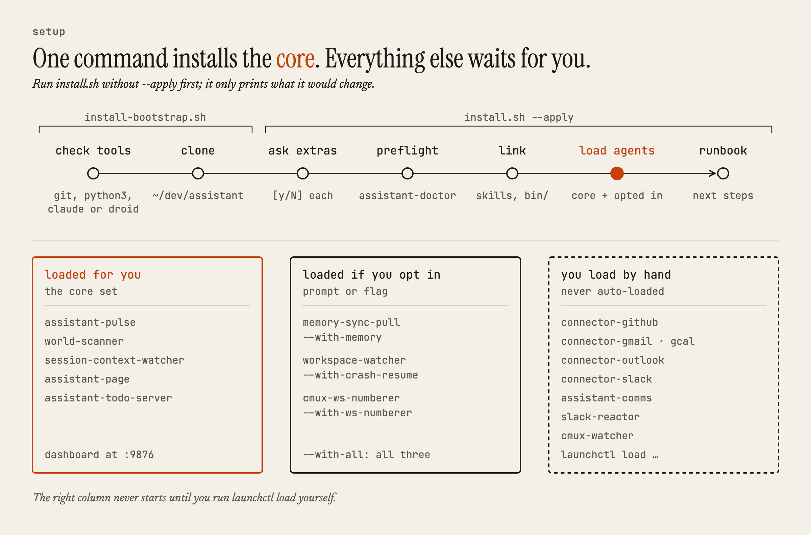

# Configuration

Assistant ships with safe defaults: silent, draft-only, and no unattended goal
work. Every setting below is a deliberate edit you make yourself.

| Setting | Default | Where | What it does |
|---|---|---|---|
| Noise budget | `page:0, notify:0` (fully silent) | `~/.assistant/noise-budget.json` | Maximum pushes a day through the interrupt gate. A `page` also requires lane `escalate`, urgency `now`, and a policy marked `pageable`. |
| Brief wake hour | `7` (local time) | `~/.assistant/comms/config.json` → `{"brief": {"wake_hour": N}}` | The first pulse at or after this hour builds the day's brief. |
| Planner autoDispatch | Off | `~/.assistant/comms/config.json` → `{"planner": {"autoDispatch": true}}` | Off: a stalled goal stages a decision for you to review. On: whitelisted steps dispatch unattended. Turn it on only after you've watched the planner behave. |
| Slack channel ingest | Mentions and DMs only | `SLACK_INGEST_CHANNELS=1` plus a manifest edit | Opts in to full channel message ingestion. See [Connect your sources](connectors.md#slack-read-only). |
| Slack focus list | Not set up | `slack_focus` block in `~/.assistant/comms/config.json` plus `SLACK_USER_TOKEN` | Which channels, bots, repos, and Jira projects the Slack tab uses. See [Slack focus list](connectors.md#slack-focus-list). |
| Connector cadence and caps | 60 s, 200 events, 10 pages | `connectors` block in `~/.assistant/comms/config.json` | Per-connector poll interval and batch caps. The module constants are only the fallback. |
| Model provider | Claude | `bin/assistant-llm.py set claude\|droid [--feature <name>]` | Chooses Claude Code or Factory Droid for all model work, or for one feature: `triage`, `observer`, `observer_audit`, `strategist`, `narrator`, `lessons`, or `slack_judge`. `bin/assistant-llm.py status` shows the current routing. |

## Strategist

The Strategist is the model that drafts context for staged goal steps. Set it
in `~/.assistant/comms/config.json` under `{"strategist": {…}}`:

- `enabled`: default `true`.
- `dailyCostCeilingUsd`: the day's model budget, default `5.0`. When it's hit,
  the Strategist is cut first, never the Observer.

Each goal in `~/.claude/assistant-goals.json` can also set
`budget.maxStrategistCallsPerDay` (default `1`).

With planner autoDispatch off, the Strategist only improves the text of staged
decisions that you review. It never starts unattended work.

## Opt-in daemons

<picture>
  <source media="(prefers-color-scheme: dark)" srcset="images/install-dark.png">
  
</picture>

A bare `./install.sh --apply` loads the core set only. Turn on a feature daemon
at the installer's `[y/N]` prompt or with a flag:

| Flag | Turns on |
|---|---|
| `--with-memory` | `memory-sync-pull`: cross-machine lesson and memory sync |
| `--with-crash-resume` | `workspace-watcher`: auto-resumes crashed cmux workspaces |
| `--with-ws-numberer` | `cmux-ws-numberer`: a `[N]` suffix and color on every workspace |
| `--with-all` | All of the above |

Slack comms and the Slack reactor are never auto-loaded, even with
`--with-all`. [ONBOARDING.md](../ONBOARDING.md) covers how answers are
remembered and how to change your mind.
