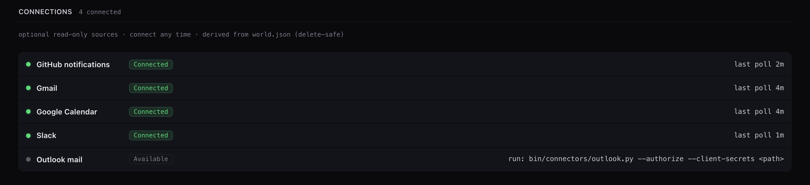

# Connect your sources

Connectors are optional, read-only daemons. Each one turns a single source into
WorldEvents, and `tests/test_keel_connector_readonly.py` fails the build if a
connector script contains a mutation or send call.

Connectors are part of Pro mode. While Pro mode is off, a connector you've set
up pauses before its next check, and it resumes at the first check after you
turn Pro mode back on. Alerts from while it was off aren't fetched later.



The starter rules send each connector's event kinds to these lanes:

| Connector | Signs in with | Escalate | Staged | Digest | Drop |
|---|---|---|---|---|---|
| GitHub | The `gh` CLI token | `mention`, `team_mention`, `security_alert` | `review_requested`, `assign`, `comment` | `ci_activity`, `author` | |
| Gmail | Google desktop OAuth, read-only scope | `direct` | | `message` | `newsletter` |
| Google Calendar | The same Google client | | Event in 1 hour | Event in 24 hours | |
| Outlook | Azure public client with `Mail.Read` | `direct` | | `cc`, `message`, `newsletter` | |
| Slack | Bot token through the Slack reactor | `app_mention`, `dm` | | Opt-in channel `message` | |

`install.sh --apply` copies every connector plist into `~/Library/LaunchAgents/`
but never loads one, so the last step for any connector is a manual
`launchctl load`.

## GitHub notifications

The connector uses the `gh` CLI's own token.

```bash
gh auth login          # if you're not already logged in
launchctl load ~/Library/LaunchAgents/com.assistant.connector-github.plist
```

## Gmail (read-only)

You need a one-time Google Cloud OAuth client on your own Google account.

1. In Google Cloud Console, enable the Gmail API for a project, create an OAuth
   client of type **Desktop app**, and download its client-secrets JSON (the
   `{"installed": …}` file).
1. Seed the token cache, then load the daemon. The first command opens the
   Google consent screen and also prints the URL for headless use. Approve the
   read-only scope.

   ```bash
   bin/connectors/gmail.py --authorize --client-secrets /path/to/client_secret.json
   launchctl load ~/Library/LaunchAgents/com.assistant.connector-gmail.plist
   ```

The refresh token is stored with mode `0600` at
`~/.assistant/connectors/gmail/token.json` and refreshed in-process. To replace
an existing cache, re-run with `--force`.

## Google Calendar (read-only)

Calendar uses the same Google Desktop OAuth client as Gmail. It emits
`event_upcoming` reminders 24 hours and 1 hour before an event.

```bash
bin/connectors/gcal.py --authorize --client-secrets /path/to/client_secret.json
launchctl load ~/Library/LaunchAgents/com.assistant.connector-gcal.plist
```

## Outlook and Microsoft 365 (read-only)

You need a one-time Azure app registration in your own Azure or Microsoft 365
tenant.

1. In the Azure Portal, register an app under **Mobile and desktop
   applications**. It's a public client, so don't create a client secret. Set
   the redirect URI to `http://localhost` (not `127.0.0.1`; the sign-in
   service's loopback exception only covers `localhost`), and turn **Allow
   public client flows** on. Add the scopes `Mail.Read`, `User.Read`, and
   `offline_access`. The client-secrets JSON needs only `client_id`.
1. Seed the token and load the daemon. If you authorized a narrower scope set
   before, re-run with `--force`.

   ```bash
   bin/connectors/outlook.py --authorize --client-secrets /path/to/azure_client.json
   launchctl load ~/Library/LaunchAgents/com.assistant.connector-outlook.plist
   ```

## Slack (read-only)

The Slack connector rides the existing Bolt app in
[`slack-reactor/`](../slack-reactor/README.md). The reactor receives the
@-mention and DM events and spools them to
`~/.assistant/connectors/slack/spool/`, where `bin/connectors/slack-events.py`
picks them up, so the reactor needs to run too (see
[Capture a Slack thread as a TODO](#capture-a-slack-thread-as-a-todo)).

1. Add the connector's two read-only handlers by re-uploading
   `slack-reactor/slack/manifest.json` to your existing app at api.slack.com/apps.
   Then reinstall the app. A scope or event change forces OAuth re-consent; if
   you skip the reinstall, the connector silently produces nothing.
1. Add `export SLACK_BOT_TOKEN=xoxb-…` to `~/.zprofile`.
1. Load the daemon:

   ```bash
   launchctl load ~/Library/LaunchAgents/com.assistant.connector-slack.plist
   ```

By default, the connector ingests @-mentions and DMs only. For full channel and
group messages, add `message.channels` and `message.groups` to the manifest and
`export SLACK_INGEST_CHANNELS=1`.

## Capture a Slack thread as a TODO

React to any Slack thread with this machine's emoji (`TODO_EMOJI`), and the
whole thread, every message plus a link back, becomes a TODO in
`~/.claude/assistant-todo.json`. That's the same store the `/todo` skill, the
pulse, and the dashboard read. Each machine claims its own emoji, so one shared
bot can route reactions to whichever laptop owns that emoji.

You need `SLACK_APP_TOKEN` and `SLACK_BOT_TOKEN` in `~/.zprofile`. Then:

```bash
launchctl load ~/Library/LaunchAgents/com.assistant.slack-reactor.plist
```

See [slack-reactor/README.md](../slack-reactor/README.md) for setup details.

## Slack comms

The opt-in comms daemon (`bin/comms-listen.py`) turns a private Slack channel
into a two-way line to your machine. It tells you when Assistant takes a
verified action, when a workspace needs input or finishes, and when Assistant's
heartbeat goes stale. You can reply, and a warm Claude Code session answers from
real fleet state. A send gate confines the bot to that one channel.

Setup steps are in [ONBOARDING.md](../ONBOARDING.md#optional--slack-comms-bidirectional),
and the design is in [assistant-comms-onboarding.md](assistant-comms-onboarding.md).

## Slack focus list

The dashboard's **Slack** tab lists the threads where the next move is yours:
direct asks, @-mentions, DMs, promises you made, and unread posts in channels
you watch. Rules sort every thread; one bounded model call writes short titles
and sets noise aside. Threads whose linked pull request merged or ticket closed
drop to **Auto-resolved**. The tab is read-only: it never posts, reacts, or
marks anything read.

The tab needs a Slack *user* token, because only user tokens can search
messages, and a `slack_focus` block that says what to watch. Nothing about you
is hard-coded: your Slack ID, name, and workspace come from the token.

1. Create or reuse a Slack app with these user token scopes: `search:read`,
   `channels:history`, `groups:history`, `im:history`, `mpim:history`,
   `channels:read`, `groups:read`, `im:read`, `mpim:read`, `users:read`, and
   `usergroups:read`. Install it and copy the `xoxp-` token.
1. Add `export SLACK_USER_TOKEN=xoxp-…` to `~/.zprofile`. The **Refresh**
   button sources that file, so the token never lands in a config file or
   plist.
1. Add a `slack_focus` block to `~/.assistant/comms/config.json`:

   ```json
   {
     "slack_focus": {
       "days": 7,
       "title": "Slack focus",
       "watched_channels": {"C0123456789": "my-team"},
       "bot_authors": ["Deploy Bot"],
       "skip_channels": ["deployments"],
       "github_repos": ["my-org/my-repo"],
       "github_hosts": ["github.com"],
       "jira": {"enabled": false, "base_url": "https://jira.example.com", "project_keys": ["ABC"],
                "token_env": "JIRA_API_TOKEN"}
     }
   }
   ```

| Setting | What it does |
|---|---|
| `days` | How far back to look, 1–30. Default 7. |
| `title` | The heading inside the Slack tab. The tab itself is always labeled **Slack**. |
| `watched_channels` | Channel ID → a label for your own reference. Every thread there counts, not only the ones that mention you. Mentions and DMs are always checked. |
| `bot_authors` | Display names of bots. A thread whose latest message is from one of them is treated as a bot post. |
| `skip_channels` | Channel-name fragments to treat as bot noise, such as `deployments`. |
| `github_repos` | Repos where your merged PRs can retire an ask ("already done"). Uses `gh`. |
| `github_hosts` | Hosts whose pull request links count, for GitHub Enterprise. Default `github.com`. |
| `jira` | Optional. With `enabled` and `project_keys`, a thread whose linked tickets are all done is auto-resolved. The token comes from the env var named in `token_env` (default `JIRA_API_TOKEN`), sent as a bearer token. For Jira Cloud, set `email_env` to the env var that holds your account email, such as `JIRA_EMAIL`, to use basic auth. `base_url` must start with `https://`; it falls back to `$JIRA_BASE_URL`. |

Open the **Slack** tab and select **Refresh from Slack**. A 7-day pull takes
about 4 minutes, plus up to a minute for the model step; a refresh stops after
20 minutes. A Slack error, such as a missing scope or a rate limit that doesn't
clear, stops the refresh and shows the error on the tab, so the list is never
built from a partial pull.

- To refresh from a terminal, run `python3 bin/slack-focus.py`. Add `--triage`
  to reuse the last pull or `--no-judge` to skip the model.
- Files live in `~/.assistant/slack-focus/`.
- To route the model step to Droid, run
  `bin/assistant-llm.py set droid --feature slack_judge`.
- If you're moving from the standalone focus board, copy its `out/done.json` to
  `~/.assistant/slack-focus/done.json` to keep your check-offs.
