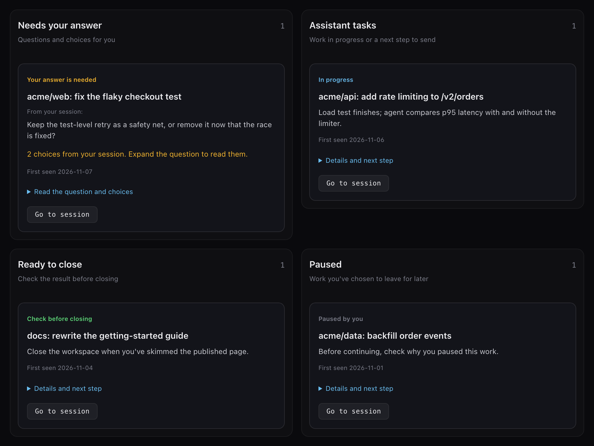

# Use the dashboard

Open the dashboard at http://127.0.0.1:9876. `bin/todo-server.py` serves it on
localhost only. The server answers one connection at a time and closes any
connection that stays silent for two seconds, so an unused browser connection
can't freeze the page.

If you open the saved file
`~/.claude/assistant-dashboard.html` straight from disk instead, only **Refresh
now** on the Notifications tab and the signal that you looked at it reach the
server; every other button needs the page served at http://127.0.0.1:9876.



Nothing pushes or notifies you by default. Once decisions are on, neglected ones
fall back to the digest instead of nagging you.

When the Assistant is about to trim oversized logs, a notice says so in an
amber bar at the top of the page, above the tabs, in both modes; the same card
also appears under **Awaiting input**. See
[Configuration](configuration.md) for how to keep your logs.

## Who can change things

The dashboard answers only at an address that starts with `http://127.0.0.1` or
`http://localhost`, on any port. A forwarded port, such as
`ssh -L 9877:127.0.0.1:9876`, so `http://localhost:9877`, works. Any other
name, such as one a web page points at your machine, is refused with a
sentence that says to open http://127.0.0.1:9876.

Every request that changes something passes one check, and reading the Slack,
goal, and decision lists passes it too:

- The dashboard in your browser is let through, because the address it was
  opened at is the address it sends from, under either `127.0.0.1` or
  `localhost` on the same port. A tab you left open from before an
  update keeps working. A page on `localhost` at another port, such as a
  development server, is a different page and is refused.
- A page from any other website is refused (403), and so is a page that tries
  to show the dashboard inside itself: the dashboard tells browsers never to
  put it in a frame.
- A call with no origin, or the origin `null`, needs the token. That covers the
  dashboard opened as a local file, a command-line call with `curl`, and a page
  sandboxed inside another website. The token is in `~/.assistant/api-token`,
  created the first time it's needed and readable by you only. Send it as the
  `X-Assistant-Token` header. Put it on standard input rather than on the
  command line, where other users can see it:

  ```bash
  curl -s -X POST http://127.0.0.1:9876/goal/list \
    -H @- <<<"X-Assistant-Token: $(cat ~/.assistant/api-token)"
  ```

  If the file doesn't exist yet, the first call is refused and creates it; run
  it again. The saved page holds the token, so `assistant-dashboard.html` is
  readable by you only too. Delete `~/.assistant/api-token` to get a new one;
  the next page rebuild puts it in the page.

If you forward the dashboard's port through another local server or tunnel,
every page that address serves is treated as the dashboard's own page.

The saved page always talks to `http://127.0.0.1:9876` when you open it as a
file, and it holds your token. Don't share it: a copy opened on another
computer would send that computer's own `127.0.0.1` the token it carries.

This protects you from web pages open in your browser, including ones that try
to show the dashboard inside themselves. It does not protect you from other
programs running as you on this Mac: they can read the token file and the saved
page, so they can do whatever the dashboard can.

## Tabs

- **Sessions**: your default view. It counts open cmux workspaces, not GitHub
  alerts. **Go to session** focuses a workspace; expand a card for details.
- **Notifications**: your notifications and the morning brief, separate from
  your session workload: GitHub alerts and other notifications, completed
  actions, other updates, and service status. Decisions and the brief are off until you turn them on. With
  them off, the tab says so and how to turn them on, and decisions that were
  already open keep showing: urgent ones until you answer them, others until
  they expire. With the brief on, a copy is saved each morning; with it off, the
  tab is a live summary and no copy is saved.
- **Slack**: the threads where the next move is yours, sorted into **Do
  first**, **Promise**, **This week**, and **Optional**. **Done** checks a row
  off until its thread gets a new reply. Setup is in
  [Slack focus list](connectors.md#slack-focus-list).
- **Connected apps**: every connector as **Connected**, **Available, not
  connected**, or **Needs attention**, with a how-to-connect hint inline.
- **Awaiting input**, **Session details**, **Background work**, and **Tasks**
  show open cards, per-workspace detail, background work, and your TODO list.
  The Tasks tab also shows a **Dispatch paused** card when Assistant started
  no task this round because it couldn't count your busy sessions. In Pro mode
  a card whose title reads "can't record what it types" can also appear: it
  means Assistant couldn't write its record of what it types into your
  sessions. For that one, check that your disk
  isn't full (`df -h ~`) and that `~/.assistant/effects` can be written to
  (`ls -ld ~/.assistant/effects`). The card lists the tasks still waiting.
  When Assistant had already started a session for a task and then wouldn't
  type into it, it parks that task (it shows as blocked) and the card names it
  and the workspace left open for it: close that workspace, then press
  "Queue to start" on the task, which turns it back into an open task for the next
  round. The card stays as long as a parked task does, even on rounds where
  nothing is blocked. A name cmux gives a session that Assistant doesn't
  recognise has its own card, which says the tasks waiting will park the same
  way until you update Assistant. If you turn Pro mode off, a task parked in
  Pro mode stays blocked: close its workspace and press "Queue to start" on it.
  See
  [Typing into agent sessions](effects.md#typing-into-agent-sessions).

## Decisions and goals

Decisions, the morning brief, and the goals planner are off by default. In Pro
mode, **Settings and background services** lists each as on or off, with the
setting that controls it. See
[Configuration](configuration.md#background-jobs-that-are-off-by-default).

- Once decisions are on, from a decision card you can accept, edit, reject, or snooze. Each choice is
  recorded in the decision log. **Wrong lane** rejects the decision and files a
  policy proposal for that source and kind, so the rules learn from the tap.
- The `/goal` skill adds, lists, reranks, and pauses goals, for example
  `/goal add "…" --outcome "…"`. Once the planner is on, goals feed it and lift
  a decision's rank within its lane. Automation can only propose goal changes; only you edit
  the goal store.

## How the overview stays honest

The overview shows when its snapshot was checked. After 10 minutes without a
fresh snapshot, completion suggestions disappear, workspace buttons turn off,
and the session count shows **?**.

**Needs you** means a specific request, not missing information. Outstanding
agent questions show their actual choices. Ordinary responses appear under
**Updates, not decisions**; missing or expired evidence appears under
**Unverified sessions**. Neither category inflates your decision count.

The transcript watcher keeps the first request, latest human request, and latest
text response separate from tool traffic. Longer responses keep their beginning
and ending, so a closing question isn't lost. Answers remove completed tool
questions through their matching tool-result IDs.

Reviewed return notes in `~/.assistant/session-return-notes.json` can add a
short goal, progress summary, and concrete next action. Every note must match
the workspace, surface, provider, session, and current
`guidance_context.source_version`. A changed conversation invalidates the note
immediately; current quoted evidence replaces it rather than presenting an
obsolete plan. Closing remains your decision: the dashboard never closes,
resumes, or sends instructions to a session. Close-out evidence can be a merged
pull request or an unchanged, hash-verified planning document. A delivered plan
doesn't imply that implementation has started.

**Agent work** distinguishes a running tool from a reviewed next step. For a
prepared continuation, **Copy next step** carries the goal, recorded progress,
and next action back to the original session. Copying never sends it.

Saved context must match the current workspace and session identities. Missing
or unsupported session bindings stay unknown instead of borrowing another
session's notes. **First recorded** is the session's start as cmux recorded it,
or its SessionStart in `~/.claude/cmux-registry.json` when cmux has no record; a
session restored into another workspace keeps its original start. The
`/back-off` skill saves the workspace identity so the overview can confirm
**Parked**. If you run the dashboard from a separate checkout, use its displayed
confirmation command for older pause records; your globally installed skill
might still use the older version.

The Notifications tab reads the current decision log and groups GitHub alerts by
pull request. It shows three groups first; expand the rest or an individual
alert's history when you need it. GitHub counts include closed pull requests
with follow-ups, and never represent cmux workspaces. Old `#brief` bookmarks
still open this inbox; **Back to sessions** returns to your workspace view.
Optional `~/.assistant/decisions/focus.json` records order matching open topics
and provide dated recommendations. Old Assistant snapshots appear as **Saved
requests**, without current-decision badges or workspace-opening actions.

Approved historical-alert cleanup uses `decisions.expire_selected`: exact record
fingerprints, a locked preflight, private backups, and an atomic log update. Its
private receipt doesn't enter the outgoing action ledger. It never approves,
merges, closes, or completes the work those alerts represent.

## Repeated failures

When the same failure happens three times in a row, it shows in one red box at
the top of the page, with the count since it began. The box shows two lines;
any others are inside "and N more that keep repeating", which opens when you
click it. For example: "Self-update has failed 14 times in a row since Monday
09:10. The error was: fetch failed: fatal: couldn't find remote ref feat/x. It
tries again by itself at 15:10, or as soon as the branch or remote it updates
from changes. To
try now, run `'/path/to/python' '/path/to/assistant/bin/self_update.py' --force`
in a terminal." The command names the Python the services use and quotes both
paths, so you can paste it as it is. The error is shortened to 100 characters.
Once the run is more than six days old the line gives the date as well as the
weekday. The lines cover self-update, background model calls, and the page
refresh after an edit. Two failures that differ only in a number, an id, or a
path count as the same one. A 401, 403, 404, or 429 stays apart from other
errors, but 500, 502, 503, and 529 count as one outage.

Sessions flagged as ready to merge with no pull request linked share one line,
for example: "Assistant has flagged 2 sessions (Fix login, Docs) as ready to
merge, but neither has a pull request linked. Open each session and link its
pull request, or tell it the work isn't ready." It names the sessions only when
every one has a title and there are three or fewer. The line goes away when
each session has a pull request linked, is no longer ready to merge, or closes.

A background job that keeps failing the same way stops calling the model, and
so stops spending, until its pause ends: an hour after the third failure, then
two, four, and so on up to 24 hours. Self-update, the lesson, strategist,
morning brief, Observer audit, and triage model calls work this way.
Self-update never waits more than 4 hours. Requests you make, such as a Work
queue or Slack tab refresh, are never paused. A pause ends by itself, and the
line clears when the next attempt works. A paused job makes no attempts, so a
pause ends when its time is up, or earlier when what it was failing on changes:
self-update tries again at once if its remote or branch changes, and the lesson,
strategist, morning brief, and triage jobs do the same if their model or
provider changes. The Observer audit can't know its model beforehand, so its
line says to delete `~/.assistant/failures.json` once you've fixed the cause.
Deleting that file forgets every count and clears every pause.

If the page itself can't be rebuilt, the page can't show this box. It appears
once a rebuild works.

The counts live in `~/.assistant/failures.json`. It keeps the 200 most recent
failures and the first 200 characters of each error, with tokens, keys, and
passwords removed. A sample can still include a branch name or a model id. The
file doesn't go to the actions ledger or to Slack.

## Dashboard writing style

Follow [Google's voice and tone guide](https://developers.google.com/style/tone)
and [style highlights](https://developers.google.com/style/highlights). Address
the reader as "you," use active voice, and explain the next step in everyday
words. Prefer "Last checked" to "Snapshot," "Not checked yet" to "Unverified,"
and "Check before closing" to "Review close-out."

Keep the original session name, questions, choices, and supporting records in
the expanded details. Don't rewrite quoted evidence or weaken conditions such as
"check the result before ignoring a failed test." Saved summaries can use
clearer wording without changing their session IDs, matching checks, or
suggested action.

`tests/test_dashboard_voice.py` requires a plain display label for every session
state and rejects internal terms in those labels. Browser checks cover the
labels, expanded original questions, and unchanged controls.
