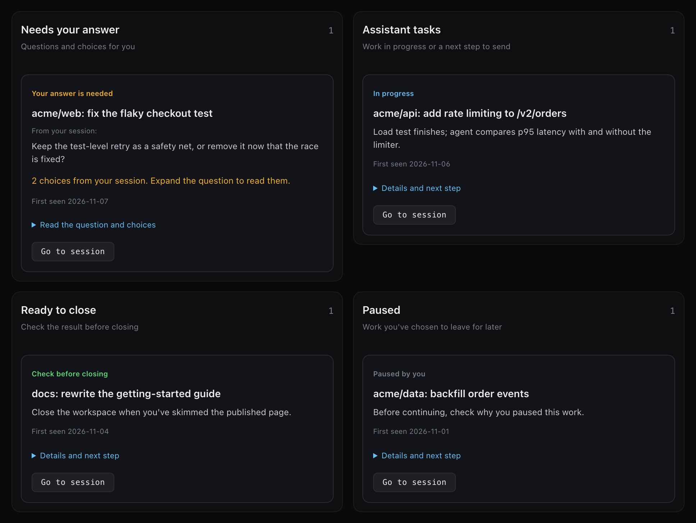

# Use the dashboard

Open the dashboard at http://127.0.0.1:9876. `bin/todo-server.py` serves it on
localhost only.

Nothing pushes or notifies you by default. Neglected decisions fall back to the
digest instead of nagging you.

## Tabs

- **Sessions**: your default view. It counts open cmux workspaces, not GitHub
  alerts. **Go to session** focuses a workspace; expand a card for details.
- **Notifications**: the morning brief, separate from your session workload:
  GitHub alerts and other notifications, completed actions, other updates, and
  service status.
- **Slack**: the threads where the next move is yours, sorted into **Do
  first**, **Promise**, **This week**, and **Optional**. **Done** checks a row
  off until its thread gets a new reply. Setup is in
  [Slack focus list](connectors.md#slack-focus-list).
- **Connected apps**: every connector as **Connected**, **Available, not
  connected**, or **Needs attention**, with a how-to-connect hint inline.
- **Awaiting input**, **Session details**, **Background work**, and **Tasks**
  show open cards, per-workspace detail, background work, and your TODO list.

## Decisions and goals

- From a decision card you can accept, edit, reject, or snooze. Each choice is
  recorded in the decision log. **Wrong lane** rejects the decision and files a
  policy proposal for that source and kind, so the rules learn from the tap.
- The `/goal` skill adds, lists, reranks, and pauses goals, for example
  `/goal add "…" --outcome "…"`. Goals feed the planner and lift a decision's
  rank within its lane. Automation can only propose goal changes; only you edit
  the goal store.

## How the overview stays honest

The overview shows when its snapshot was checked. After 10 minutes without a
fresh snapshot, completion suggestions disappear, workspace buttons turn off,
and the session count shows **?**.

**Needs you** means a specific request, not missing information. Outstanding
agent questions show their actual choices. Ordinary responses appear under
**Updates, not decisions**; missing or expired evidence appears under
**Unverified sessions**. Neither category inflates your decision count.

The transcript watcher keeps the first request, latest human request, and latest
text response separate from tool traffic. Longer responses keep their beginning
and ending, so a closing question isn't lost. Answers remove completed tool
questions through their matching tool-result IDs.

Reviewed return notes in `~/.assistant/session-return-notes.json` can add a
short goal, progress summary, and concrete next action. Every note must match
the workspace, surface, provider, session, and current
`guidance_context.source_version`. A changed conversation invalidates the note
immediately; current quoted evidence replaces it rather than presenting an
obsolete plan. Closing remains your decision: the dashboard never closes,
resumes, or sends instructions to a session. Close-out evidence can be a merged
pull request or an unchanged, hash-verified planning document. A delivered plan
doesn't imply that implementation has started.

**Agent work** distinguishes a running tool from a reviewed next step. For a
prepared continuation, **Copy next step** carries the goal, recorded progress,
and next action back to the original session. Copying never sends it.

Saved context must match the current workspace and session identities. Missing
or unsupported session bindings stay unknown instead of borrowing another
session's notes. **First recorded** is the session's start as cmux recorded it,
or its SessionStart in `~/.claude/cmux-registry.json` when cmux has no record; a
session restored into another workspace keeps its original start. The
`/back-off` skill saves the workspace identity so the overview can confirm
**Parked**. If you run the dashboard from a separate checkout, use its displayed
confirmation command for older pause records; your globally installed skill
might still use the older version.

The Notifications tab reads the current decision log and groups GitHub alerts by
pull request. It shows three groups first; expand the rest or an individual
alert's history when you need it. GitHub counts include closed pull requests
with follow-ups, and never represent cmux workspaces. Old `#brief` bookmarks
still open this inbox; **Back to sessions** returns to your workspace view.
Optional `~/.assistant/decisions/focus.json` records order matching open topics
and provide dated recommendations. Old Assistant snapshots appear as **Saved
requests**, without current-decision badges or workspace-opening actions.

Approved historical-alert cleanup uses `decisions.expire_selected`: exact record
fingerprints, a locked preflight, private backups, and an atomic log update. Its
private receipt doesn't enter the outgoing action ledger. It never approves,
merges, closes, or completes the work those alerts represent.

## Dashboard writing style

Follow [Google's voice and tone guide](https://developers.google.com/style/tone)
and [style highlights](https://developers.google.com/style/highlights). Address
the reader as "you," use active voice, and explain the next step in everyday
words. Prefer "Last checked" to "Snapshot," "Not checked yet" to "Unverified,"
and "Check before closing" to "Review close-out."

Keep the original session name, questions, choices, and supporting records in
the expanded details. Don't rewrite quoted evidence or weaken conditions such as
"check the result before ignoring a failed test." Saved summaries can use
clearer wording without changing their session IDs, matching checks, or
suggested action.

`tests/test_dashboard_voice.py` requires a plain display label for every session
state and rejects internal terms in those labels. Browser checks cover the
labels, expanded original questions, and unchanged controls.
