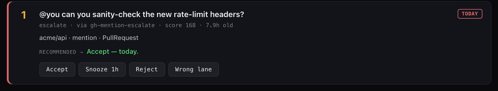

# Design reference

This page collects the reasoning behind Assistant's structure, the rules it
never breaks, and a map of the code. For the short version, see the
[README](../README.md#features).

## The five lanes

Every WorldEvent goes through the ordered policy rules, and the first match
wins. A rule sends the event to one of five lanes:

- **auto**: a reversible action, recorded.
- **staged**: a decision for you to review.
- **escalate**: a decision at the top of the brief.
- **digest**: an FYI line that expires in 24 hours.
- **drop**: a receipt only, from an explicit rule.

An event that no rule matches opens as escalate first. A triage model may then
attach staged, escalate, or digest as a suggestion; its lane map has no auto or
drop.

Pure Python assigns lanes (`src/assistant/policy.py` plus
`config/policies.bootstrap.json`), and decisions land in an append-only log at
`~/.assistant/decisions/decisions.jsonl`. An `auto` rule may only declare
`todo.create` or `digest.append`, and no bootstrap rule uses that lane.

Every bootstrap rule has a fixture in `evals/policy/<rule-id>/`, and
`tests/test_policy.py` checks the coverage. A version bump in the bootstrap file
adds missing rule IDs to your installed copy and never overwrites or removes
your own rules.

## Ranking the brief

Each open decision scores its lane (escalate 100, staged 60, digest 20) plus
urgency (now 50, high 20) plus freshness (20, minus 5 a day) plus a goal boost
(up to 20), and the queue sorts by lane first. Each decision card shows its
lane, the rule that placed it, and its score:

`src/assistant/brief.py` ranks open decisions with the fixed formula above. The
brief is a pure derivation of other stores: delete
`~/.assistant/brief/brief-<date>.json` and `bin/build-morning-brief.py` rebuilds
the same bytes. The daily metrics row in
`~/.assistant/brief/brief-metrics.jsonl` records `decisions_pending_at_brief`,
interrupts delivered and denied, expired-unseen decisions, and goal progress.

The pulse runs every 5 minutes. A brief that stays unseen for 48 hours moves
its open, non-escalated decisions to the digest and seeds rule proposals.

## Outbound actions

Two paths lead out of Assistant:

- **Notifications** go through the interrupt gate: a level check, a
  once-per-key-per-day dedup, and a budget with a default of page 0, notify 0.
  Only if all three pass does a macOS alert fire.
- **Actions** go through the outbound dispatcher: you must have accepted the
  decision, the action class must be enabled, and the class gate decides.
  `email.send` and `slack.reply.send` are forbidden, `draft_only` classes stage
  a local draft, and `confirm` and `standing` classes aren't wired yet.

Every refusal is recorded.

`bin/outbound-dispatch.py` is the only sanctioned way to act on an accepted
decision, and `bin/interrupt-gate.py` is the only path to a notification. Sends
are forbidden twice: in `config/action-classes.bootstrap.json` and in code
(`_CODE_FORBIDDEN` in `src/assistant/action_classes.py`), which also rejects any
class ending in `.send`. The code pins a minimum strictness, so a config edit
can't loosen `github.merge` or `ws.close` below `confirm`.

## Fleet actions

With the Observer on (`ASSISTANT_WATCHER=1`), it gives each workspace one
verdict: `ready_for_merge`, `ready_for_cleanup`, `stranded`, `needs_user`,
`active`, or `no_action`.

A Python lookup table in `bin/pulse.py` turns each verdict into an action. A
`stranded` verdict must carry `nudge_text`, but the pulse sends a fixed, safe
retry message rather than the model's text. `bin/merge-pr-dispatch.py` refuses
feature and bug-fix pull requests, then reads the workspace transcript to
confirm the agent received the merge command. It's written for the author's own
repository and merge skills, so expect to adapt it.

TODOs flagged `autoDispatch` are spawned into fresh cmux workspaces with hard
caps: at most 5 busy workspaces, 30 total, and 2 new spawns per pulse.

## Design decisions

**Verdicts are data; actions are code.** The Observer only emits a verdict.
Turning it into an action is a Python dictionary, so bugs are diffs and unit
tests, not prompt rewrites, and behavior can't drift because a model decided
something different.

**Pull request data comes from `gh`, not from the agent's prose.** An earlier
version scraped PR numbers from transcript text and closed workspaces based on
unrelated merged PRs mentioned in passing. That pipeline is gone. PR state comes
from `gh pr view` run in the workspace's own directory. The Observer eval
fixture `01-ws97-trap-no-pr-mid-audit` replays that bug.

**A wrong transcript is worse than none.** `bin/build-ws-context.py` attaches
`transcript_path` only when it's verified to belong to the workspace's live
agent. Otherwise it's `null`, and the Observer judges from the live terminal
screen instead of a mismatched transcript.

**Project lessons belong in project repos.** A lesson about one codebase
loading into every unrelated coding session is noise. `bin/assistant-curator.py`
routes each lesson by `--target`: your global Claude Code rules, the Observer's
prompt, the Strategist's drafting lessons, or a project repo's `.claude/rules/`,
where it's committed automatically.

**Memory is layered.** Lessons (rules in prompt and rule files), semantic memory
(Mem0 at `~/.assistant/mem0/`), human-readable notes (an Obsidian vault), and
cross-machine sync (a private memory repo) each serve a different reader: the
model, an agent doing semantic search, and you.

**Patterns learn from feedback.** The cmux-watcher pattern bank
(`~/.assistant/pattern_bank.json`) reloads when the file changes. Patterns that
draw corrections get downgraded to `muted` by `bin/tools/pattern-feedback.py`.

## Rules Assistant never breaks

- **It never closes a cmux workspace.** It sends slash commands into
  workspaces; closing is your call. `tests/test_no_close_workspace.py` fails if
  any code, skill, or prompt invokes a workspace close.
- **It never loads a daemon you didn't ask for.** `install.sh --apply` reloads
  the core set plus any feature you opted into. Connectors, cmux-watcher, Slack
  comms, the Slack reactor, and the single-process daemon are always loaded by
  hand, because the pulse self-update re-runs the installer unattended.
- **It never sends as you.** Outbound sends are forbidden in config and in code;
  see [Outbound actions](#outbound-actions).

## Gotchas

- **Self-update refuses a dirty or ahead tree.** `bin/self_update.py` only
  fast-forwards. A dirty tree is reported, never overwritten.
- **Self-update clears a stale git lock.** A `.git/index.lock` older than 10
  minutes is removed before the update when `lsof` shows no process has it open
  and no git process is working in the repo. A young or live lock is left
  alone, and every removal is recorded.
- **`NO_INGEST_GUARD` stops resend loops.** If the last send to a workspace
  returned `transcript_size_delta=0` (cmux sent it, but no Claude process was
  reading) and the verdict hasn't changed, the pulse skips the next resend.
- **The single-process daemon is opt-in.** `src/assistant/` can run the decision
  spine and pulse in one process (`python -m assistant`), but the pulse
  LaunchAgent keeps running until you switch over.
- **Mem0 needs Python 3.12.** It lives in `.venv-mem0`, and `ensure_venv()`
  re-runs memory tools under that interpreter.

## Entry points

| Path | What it does |
|---|---|
| `bin/pulse.py` | The main orchestrator loop. The LaunchAgent runs it every 5 minutes. |
| `bin/assistant-daemon.py` | The opt-in single-process daemon. |
| `bin/cmux-watcher.py` | Event-driven workspace signals (opt-in LaunchAgent). |
| `bin/connectors/*.py` | Read-only source connectors (opt-in daemons). |
| `bin/build-morning-brief.py` | Rebuilds today's brief on demand. `--print` also writes the JSON to stdout. |
| `bin/plan-next-actions.py` | Runs the goals planner on demand. |
| `bin/interrupt-gate.py` | The only path to a push notification. |
| `bin/outbound-dispatch.py` | The only path to an outbound action. |
| `bin/todo-server.py` | The dashboard and JSON API at http://127.0.0.1:9876. |
| `bin/slack-focus.py` | Refreshes the Slack tab's list. |
| `bin/assistant-curator.py` | Manages lessons across every rule store. |
| `bin/assistant-doctor.py` | Preflight health check. `--only core\|slack\|all`. |
| `bin/tool-dispatch.py` | Named tool dispatcher (`bin/tools-manifest.json`). |
| `install.sh` | Dry run by default. `--apply` links skills and code, copies plists, and reloads the core set. |

## Milestones

The project grew in milestones under the internal name Keel. Code comments and
the [CHANGELOG](../CHANGELOG.md) refer to them.

| Milestone | What it added |
|---|---|
| M0 | Metering: token and cost capture on every `claude --print` (`bin/metering.py`) |
| M1 | Event spine: the typed WorldEvent inbox consumer (`src/assistant/eventspine.py`) |
| M2 | Policy engine, decision queue, and suggestion-only triage (`policy.py`, `decisions.py`, `triage.py`) |
| M3 | Morning brief and interrupt gate (`brief.py`, `bin/interrupt-gate.py`) |
| M4 | Goals and the deterministic planner (`goals.py`, `bin/plan-next-actions.py`, the `/goal` skill) |
| M5 | Connectors for GitHub, Gmail, Google Calendar, Slack, and Outlook. A Jira connector shipped here and was later removed. |
| M6 | Strategist: a throttled model drafter for staged goal steps (`src/assistant/strategist.py`) |
| M7 | Gated outbound (`bin/outbound-dispatch.py`, `src/assistant/action_classes.py`) and the brief narrator |
| M8 | Model tiers: callers ask for a tier, and one module maps it to a model ID (`src/assistant/model_tiers.py`) |
